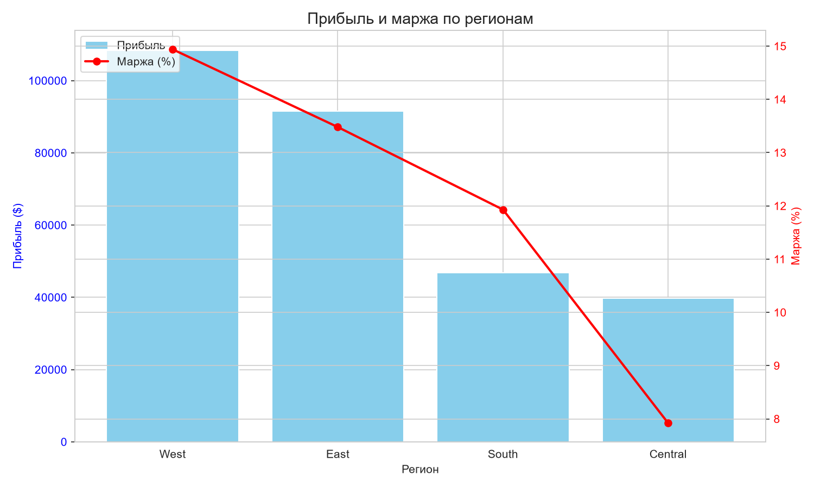
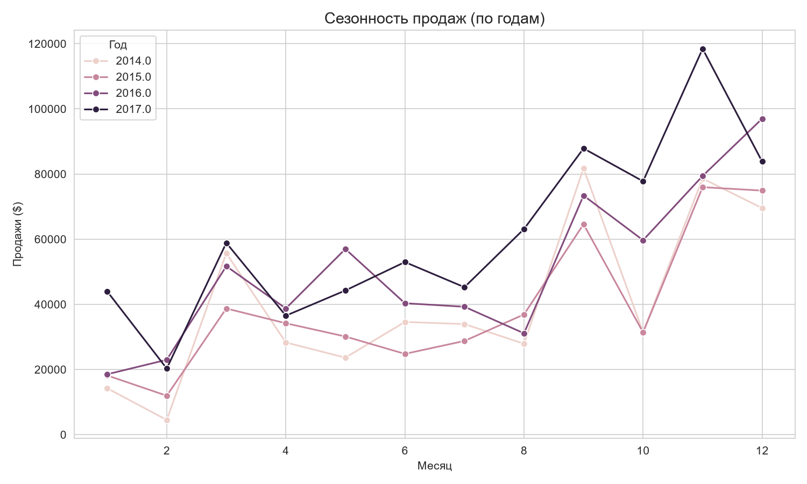
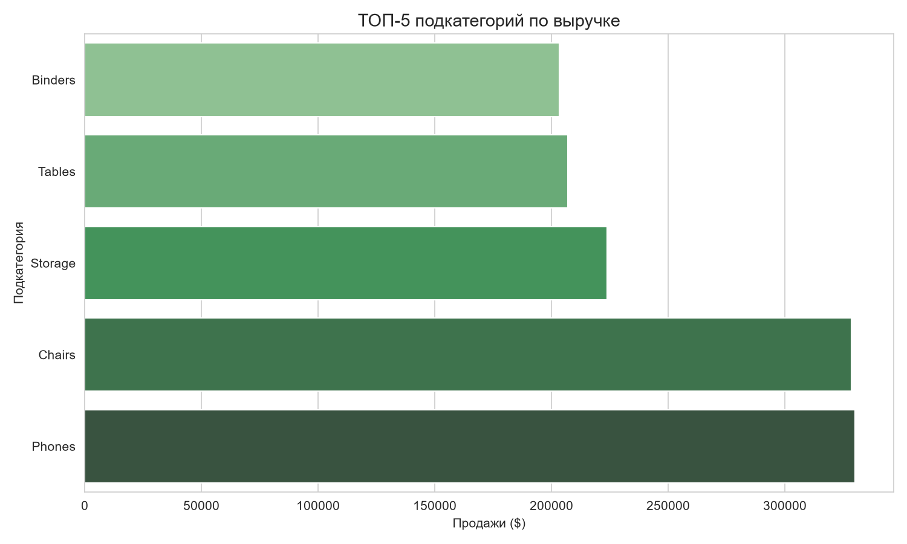

# 📊 Анализ данных Superstore (ETL & Dashboard)

Проект по извлечению, трансформации и загрузке (ETL) данных о продажах вымышленной компании Superstore в базу данных PostgreSQL с последующим анализом и визуализацией ключевых метрик.

## 🚀 О проекте

Цель проекта — продемонстрировать навыки работы с данными: от развертывания базы данных и написания SQL-запросов до визуализации результатов и создания интерактивного дашборда.

**Что умеет проект:**
* Автоматически загружает CSV-файл в базу данных PostgreSQL через `SQLAlchemy`.
* Выполняет сложные SQL-запросы (агрегация, группировка, вычисление маржинальности, работа с датами).
* Строит статические графики с помощью `matplotlib` и `seaborn`.
* Предоставляет интерактивный дашборд на базе `Streamlit` для исследования данных.

---

## 📈 Визуализация

### Прибыль и маржа по регионам


### Сезонность продаж


### Топ категорий товаров


---

## 🛠 Технологический стек

* **Язык:** Python 3.12+
* **База данных:** PostgreSQL
* **Библиотеки:** `pandas`, `SQLAlchemy`, `psycopg2-binary`, `python-dotenv`
* **Визуализация:** `matplotlib`, `seaborn`, `streamlit`

---

## ⚙️ Установка и запуск

### 1. Клонирование репозитория

```bash
git clone https://github.com/Vsevolodpy/Database-data-analysis.git
cd Database-data-analysis
```

### 2. Настройка виртуального окружения

```bash
python -m venv venv
# Для Windows:
.\venv\Scripts\activate
# Для macOS/Linux:
source venv/bin/activate

pip install -r requirements.txt
```

### 3. Развертывание базы данных (PostgreSQL)

Для работы проекта требуется запущенный экземпляр PostgreSQL. Самый простой способ — использовать Docker.

Запустите контейнер с базой данных (порт `5432` по умолчанию пробрасывается наружу):

```bash
docker run --name superstore-db -e POSTGRES_PASSWORD=mysecretpassword -p 5432:5432 -d postgres
```

> **Примечание:** Если порт `5432` у вас уже занят, замените первую цифру во флаге `-p 5433:5432` и не забудьте обновить порт в файле `.env`.

### 4. Настройка переменных окружения

Создайте файл `.env` в корне проекта и добавьте туда данные для подключения к вашей базе:

```env
DB_PASSWORD=mysecretpassword
DB_HOST=localhost
DB_USER=postgres
DB_PORT=5432
DB_NAME=postgres
```

> Файл `.env` добавлен в `.gitignore` и не попадет в репозиторий, так как содержит секреты.

### 5. Запуск ETL-процесса и дашборда

Убедитесь, что база данных запущена и `.env` настроен, затем выполните скрипт для загрузки данных:

```bash
python src/db_loader.py
```

И запустите интерактивный дашборд:

```bash
streamlit run src/app.py
```

---

## 📁 Структура проекта

```text
├── data/               # Исходные CSV-данные (Superstore)
├── reports/            # Сгенерированные графики (.png)
├── src/                # Исходный код
│   ├── app.py          # Streamlit-дашборд
│   ├── config.py       # Загрузка конфигурации из .env
│   ├── db_loader.py    # Скрипт ETL (загрузка CSV в БД)
│   ├── queries.py      # SQL-запросы для анализа
│   └── visualize.py    # Скрипт генерации графиков
├── .gitignore          # Игнорируемые файлы
├── requirements.txt    # Зависимости проекта
└── README.md           # Описание проекта
```

---

## 📄 Источник данных

Датасет `sample_superstore.csv` является открытым учебным набором данных, созданным компанией Tableau для демонстрации возможностей визуализации. Данные являются синтетическими и не содержат конфиденциальной информации.
